# MP4 기반 Video-to-Workflow Agent

> 반도체 장비 Recipe 생성과 수정 자동화를 위한 기술 설계 발표자료의 본문과 발표자 노트입니다.

## 왜 필요한가? (Why)

엔지니어가 남긴 화면 녹화 MP4에서 승인 가능한 작업 절차를 추출하고, 실제 GUI 상태를 확인하면서 Recipe Draft를 생성하거나 수정하는 구조를 설명합니다.

## 핵심 개념 (What)

- Offline에서 이벤트, Semantic Action Trace, Workflow Graph와 전문가 승인 분기를 구축합니다.
- Online에서 현재 상태에 맞는 Demo를 검색하고 Decision, Policy, Execution을 분리합니다.
- Backup, Diff, 엔지니어 승인과 사후 검증으로 변경 범위를 관리합니다.
- 실측 성능이나 운영 완료 보고가 아닌 제안 설계입니다. 예시 값과 PoC 단계는 운영 결과를 뜻하지 않습니다.

## 어떻게 사용하는가? (How)

각 슬라이드의 이미지, 본문, 표, JSON 예시와 발표자 노트를 순서대로 확인합니다. 이미지 파일은 PPTX 슬라이드를 PNG로 렌더링한 자료이며 별도의 생성형 삽화는 없습니다. 전체 Decision Context JSON Schema와 전체 JSON 예시는 슬라이드 12의 발표자 노트에 포함되어 있습니다.

슬라이드 원문은 기존 PPTX의 문구와 표기를 유지했습니다. JSON 예시 1/2와 2/2는 한 객체의 내부 필드를 나눈 발췌입니다. 이 문서는 PPTX의 레이아웃이나 연결선을 재생성하는 소스 코드는 아닙니다.

## 슬라이드 01: MP4 기반 Video-to-Workflow Agent

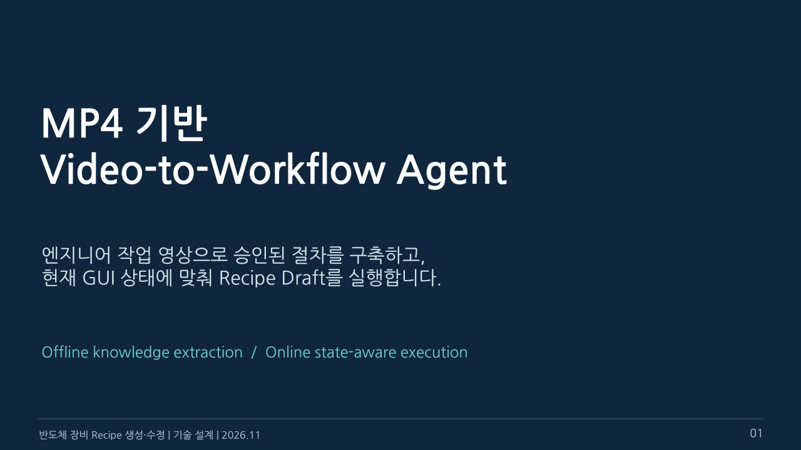

### 슬라이드 본문

엔지니어 작업 영상으로 승인된 절차를 구축하고,
현재 GUI 상태에 맞춰 Recipe Draft를 실행합니다.

Offline knowledge extraction  /  Online state-aware execution

### 발표자 노트

설계 원문: LLM 분기 컨텍스트 설계, 2026-11-08. https://chatgpt.com/c/6aef1bcb-8588-83ee-8cc6-5ddc88f7b521
본 자료는 제안 설계입니다. 실장비 운영 성능 또는 배포 완료를 의미하지 않습니다.

발표 범위는 화면만 녹화한 MP4를 시작점으로 하는 설계입니다. 작업 로그, 원본 MP4, 실장비 검증 결과는 이번 자료의 입력으로 제공되지 않았습니다. 모델 학습보다 지식 구조와 검증 가능한 실행 계약을 우선합니다.

슬라이드 하단 표기: 반도체 장비 Recipe 생성·수정 | 기술 설계 | 2026.11 / 01

## 슬라이드 02: 입력 데이터와 자동화 범위

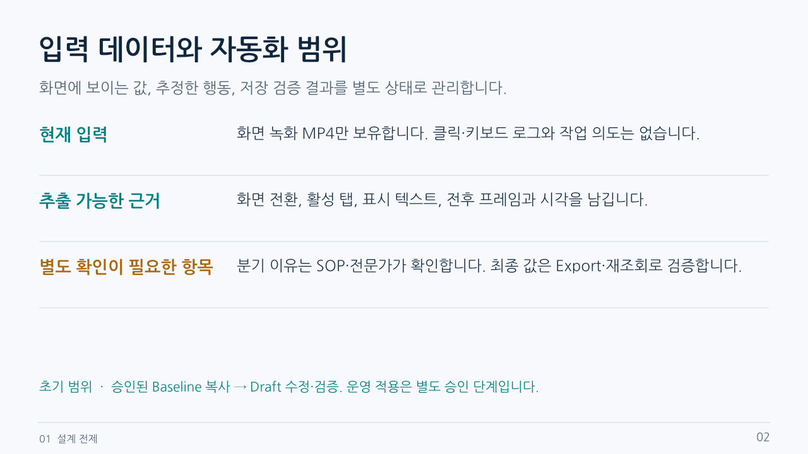

### 슬라이드 본문

화면에 보이는 값, 추정한 행동, 저장 검증 결과를 별도 상태로 관리합니다.

현재 입력

화면 녹화 MP4만 보유합니다. 클릭·키보드 로그와 작업 의도는 없습니다.

추출 가능한 근거

화면 전환, 활성 탭, 표시 텍스트, 전후 프레임과 시각을 남깁니다.

별도 확인이 필요한 항목

분기 이유는 SOP·전문가가 확인합니다. 최종 값은 Export·재조회로 검증합니다.

초기 범위  ·  승인된 Baseline 복사 → Draft 수정·검증. 운영 적용은 별도 승인 단계입니다.

### 발표자 노트

설계 원문: LLM 분기 컨텍스트 설계, 2026-11-08. https://chatgpt.com/c/6aef1bcb-8588-83ee-8cc6-5ddc88f7b521
본 자료는 제안 설계입니다. 실장비 운영 성능 또는 배포 완료를 의미하지 않습니다.

슬라이드 하단 표기: 01  설계 전제 / 02

## 슬라이드 03: 전체 아키텍처

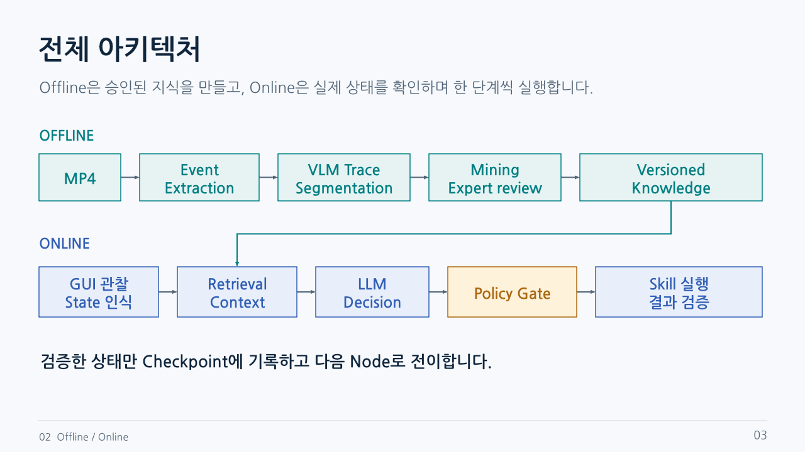

### 슬라이드 본문

Offline은 승인된 지식을 만들고, Online은 실제 상태를 확인하며 한 단계씩 실행합니다.

OFFLINE

MP4

Event
Extraction

VLM Trace
Segmentation

Mining
Expert review

Versioned
Knowledge

ONLINE

GUI 관찰
State 인식

Retrieval
Context

LLM
Decision

Policy Gate

Skill 실행
결과 검증

검증한 상태만 Checkpoint에 기록하고 다음 Node로 전이합니다.

### 발표자 노트

설계 원문: LLM 분기 컨텍스트 설계, 2026-11-08. https://chatgpt.com/c/6aef1bcb-8588-83ee-8cc6-5ddc88f7b521
본 자료는 제안 설계입니다. 실장비 운영 성능 또는 배포 완료를 의미하지 않습니다.

Knowledge는 Workflow / Skills / Policy, Demonstration, Evidence로 구분됩니다. State Store는 실행 이력과 체크포인트를 별도 영속 관리합니다. 원본 비디오 전체를 매번 LLM에 넣지 않습니다.

슬라이드 하단 표기: 02  Offline / Online / 03

## 슬라이드 04: 영상 전처리와 이벤트 후보 추출

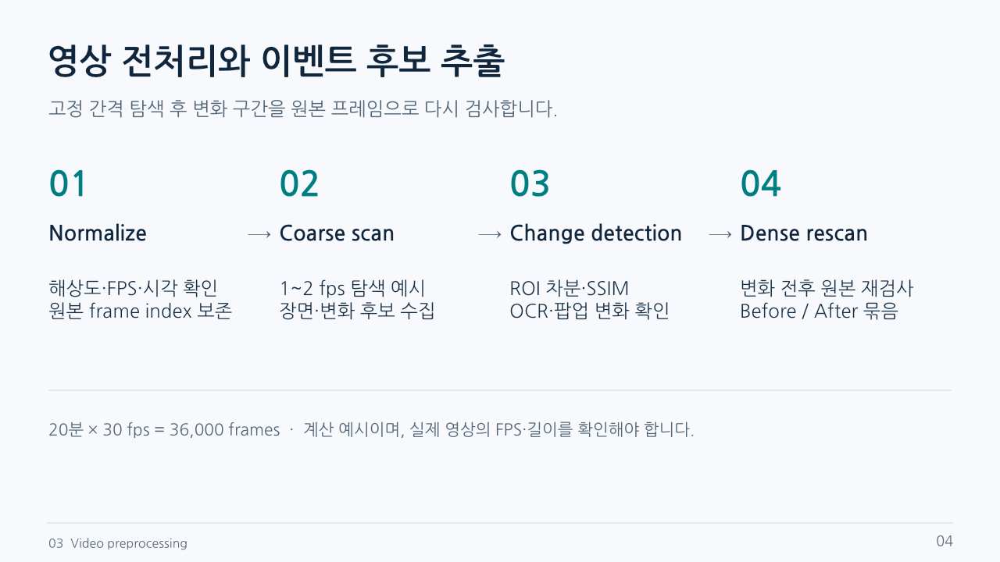

### 슬라이드 본문

고정 간격 탐색 후 변화 구간을 원본 프레임으로 다시 검사합니다.

01

Normalize

해상도·FPS·시각 확인
원본 frame index 보존

→

02

Coarse scan

1~2 fps 탐색 예시
장면·변화 후보 수집

→

03

Change detection

ROI 차분·SSIM
OCR·팝업 변화 확인

→

04

Dense rescan

변화 전후 원본 재검사
Before / After 묶음

20분 × 30 fps = 36,000 frames  ·  계산 예시이며, 실제 영상의 FPS·길이를 확인해야 합니다.

### 발표자 노트

설계 원문: LLM 분기 컨텍스트 설계, 2026-11-08. https://chatgpt.com/c/6aef1bcb-8588-83ee-8cc6-5ddc88f7b521
본 자료는 제안 설계입니다. 실장비 운영 성능 또는 배포 완료를 의미하지 않습니다.

1~2 fps는 초기 탐색 설정 예시입니다. 짧은 팝업을 모든 경우에 찾는다는 보장은 없습니다. 주기적 dense audit 또는 영상 전체의 경량 변화 감지로 coarse scan 누락을 별도로 측정합니다. 가변 FPS 영상은 실제 timestamp를 기준으로 정렬합니다.

슬라이드 하단 표기: 03  Video preprocessing / 04

## 슬라이드 05: 화면 변화 감지와 Event Package

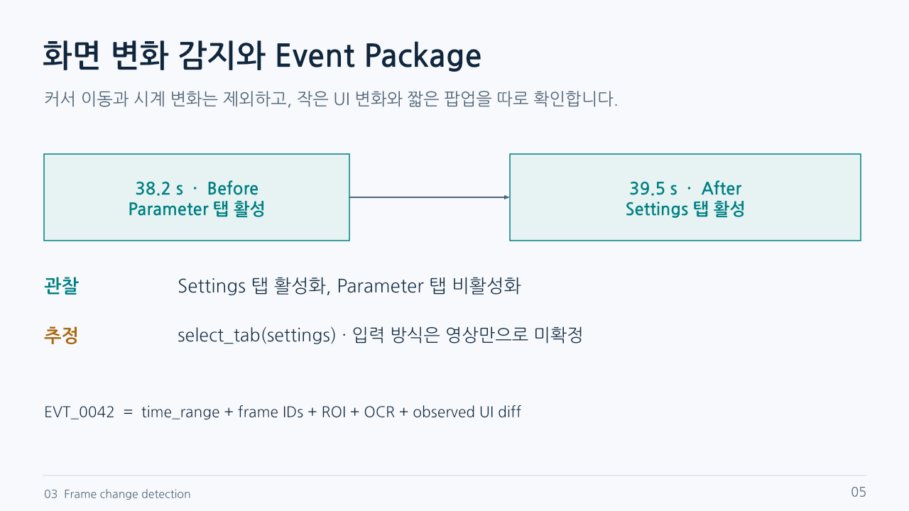

### 슬라이드 본문

커서 이동과 시계 변화는 제외하고, 작은 UI 변화와 짧은 팝업을 따로 확인합니다.

38.2 s  ·  Before
Parameter 탭 활성

39.5 s  ·  After
Settings 탭 활성

관찰

Settings 탭 활성화, Parameter 탭 비활성화

추정

select_tab(settings) · 입력 방식은 영상만으로 미확정

EVT_0042  =  time_range + frame IDs + ROI + OCR + observed UI diff

### 발표자 노트

설계 원문: LLM 분기 컨텍스트 설계, 2026-11-08. https://chatgpt.com/c/6aef1bcb-8588-83ee-8cc6-5ddc88f7b521
본 자료는 제안 설계입니다. 실장비 운영 성능 또는 배포 완료를 의미하지 않습니다.

설명용 가상 이벤트입니다. 화면 변화가 곧 클릭 증거는 아닙니다. ROI 마스크는 커서·시계를 제거하되 상태 표시·오류 영역을 가리지 않아야 합니다. 임계치는 해상도·압축·원격 세션 노이즈를 반영해 라벨 데이터로 조정합니다.

슬라이드 하단 표기: 03  Frame change detection / 05

## 슬라이드 06: VLM Semantic Action Trace

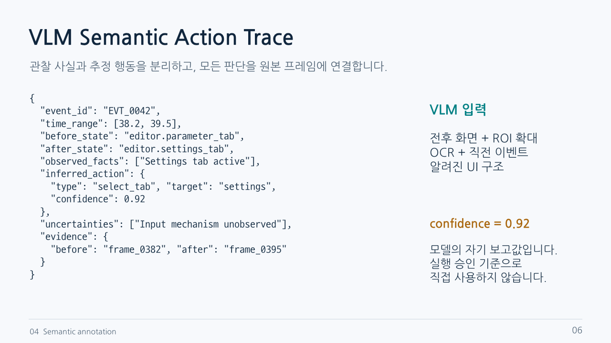

### 슬라이드 본문

관찰 사실과 추정 행동을 분리하고, 모든 판단을 원본 프레임에 연결합니다.

```json
{
  "event_id": "EVT_0042",
  "time_range": [38.2, 39.5],
  "before_state": "editor.parameter_tab",
  "after_state": "editor.settings_tab",
  "observed_facts": ["Settings tab active"],
  "inferred_action": {
    "type": "select_tab", "target": "settings",
    "confidence": 0.92
  },
  "uncertainties": ["Input mechanism unobserved"],
  "evidence": {
    "before": "frame_0382", "after": "frame_0395"
  }
}
```

VLM 입력

전후 화면 + ROI 확대
OCR + 직전 이벤트
알려진 UI 구조

confidence = 0.92

모델의 자기 보고값입니다.
실행 승인 기준으로
직접 사용하지 않습니다.

### 발표자 노트

설계 원문: LLM 분기 컨텍스트 설계, 2026-11-08. https://chatgpt.com/c/6aef1bcb-8588-83ee-8cc6-5ddc88f7b521
본 자료는 제안 설계입니다. 실장비 운영 성능 또는 배포 완료를 의미하지 않습니다.

Trace의 값은 가상 예시입니다. 숫자 confidence는 보정된 성공확률이나 실측 정확도가 아닙니다. 누락·충돌·작은 글자 인식 실패는 uncertainties로 남기고 전문가 검토 대상으로 보냅니다.

슬라이드 하단 표기: 04  Semantic annotation / 06

## 슬라이드 07: Task Segmentation과 Semantic Step

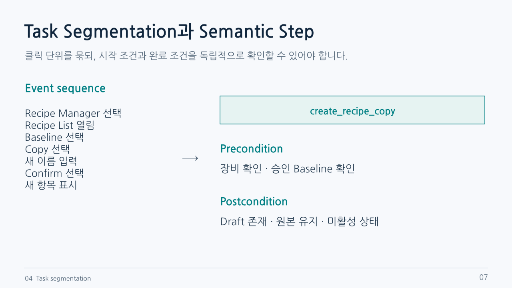

### 슬라이드 본문

클릭 단위를 묶되, 시작 조건과 완료 조건을 독립적으로 확인할 수 있어야 합니다.

Event sequence

Recipe Manager 선택
Recipe List 열림
Baseline 선택
Copy 선택
새 이름 입력
Confirm 선택
새 항목 표시

create_recipe_copy

Precondition

장비 확인 · 승인 Baseline 확인

Postcondition

Draft 존재 · 원본 유지 · 미활성 상태

→

### 발표자 노트

설계 원문: LLM 분기 컨텍스트 설계, 2026-11-08. https://chatgpt.com/c/6aef1bcb-8588-83ee-8cc6-5ddc88f7b521
본 자료는 제안 설계입니다. 실장비 운영 성능 또는 배포 완료를 의미하지 않습니다.

한 Semantic Step은 하나의 검증 가능한 작업입니다. 과도한 병합은 중간 실패를 숨기므로 전후 상태·반복·팝업을 기준으로 경계를 검토합니다. evidence에는 DEMO와 EVT 목록을 유지합니다.

슬라이드 하단 표기: 04  Task segmentation / 07

## 슬라이드 08: 여러 시연의 정렬과 Workflow Mining

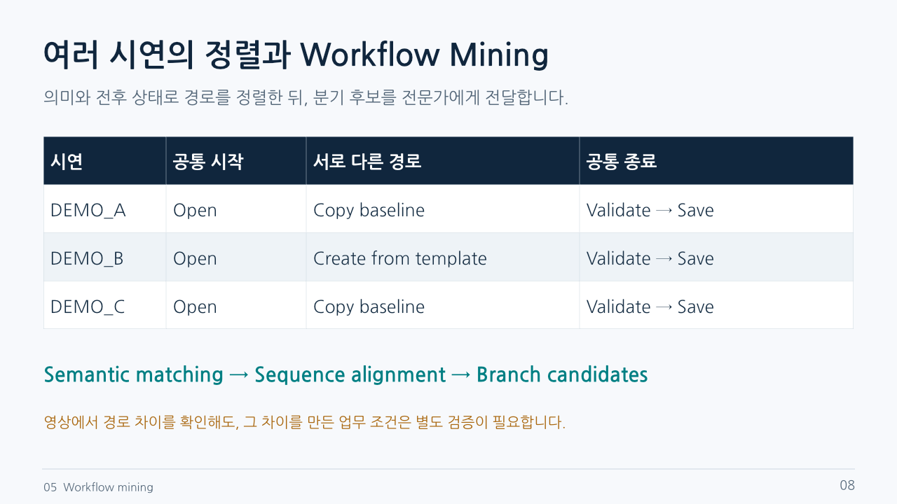

### 슬라이드 본문

의미와 전후 상태로 경로를 정렬한 뒤, 분기 후보를 전문가에게 전달합니다.

| 시연 | 공통 시작 | 서로 다른 경로 | 공통 종료 |
| --- | --- | --- | --- |
| DEMO_A | Open | Copy baseline | Validate → Save |
| DEMO_B | Open | Create from template | Validate → Save |
| DEMO_C | Open | Copy baseline | Validate → Save |

Semantic matching → Sequence alignment → Branch candidates

영상에서 경로 차이를 확인해도, 그 차이를 만든 업무 조건은 별도 검증이 필요합니다.

### 발표자 노트

설계 원문: LLM 분기 컨텍스트 설계, 2026-11-08. https://chatgpt.com/c/6aef1bcb-8588-83ee-8cc6-5ddc88f7b521
본 자료는 제안 설계입니다. 실장비 운영 성능 또는 배포 완료를 의미하지 않습니다.

표는 가상 예시입니다. 초기에는 의미·전후 상태 기반 정렬을 사용하고, 데이터가 쌓이면 Process Mining으로 반복과 예외 경로를 분석합니다. 하나의 영상이나 빈도만으로 분기 조건을 확정하지 않습니다.

슬라이드 하단 표기: 05  Workflow mining / 08

## 슬라이드 09: 전문가 분기 주석과 승인 규칙

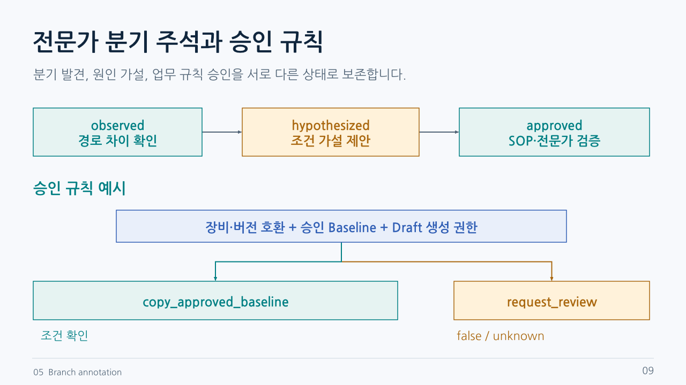

### 슬라이드 본문

분기 발견, 원인 가설, 업무 규칙 승인을 서로 다른 상태로 보존합니다.

observed
경로 차이 확인

hypothesized
조건 가설 제안

approved
SOP·전문가 검증

승인 규칙 예시

장비·버전 호환 + 승인 Baseline + Draft 생성 권한

copy_approved_baseline

request_review

조건 확인

false / unknown

### 발표자 노트

설계 원문: LLM 분기 컨텍스트 설계, 2026-11-08. https://chatgpt.com/c/6aef1bcb-8588-83ee-8cc6-5ddc88f7b521
본 자료는 제안 설계입니다. 실장비 운영 성능 또는 배포 완료를 의미하지 않습니다.

branch_id, source_state, 후보 경로, evidence IDs, condition status, reviewer, SOP revision, approval time을 저장합니다. 승인 조건을 참으로 검증한 경우에만 copy 경로를 허용하며, false 또는 unknown은 request_review로 보냅니다. 승인된 template 규칙은 별도 검토 후 추가합니다.

슬라이드 하단 표기: 05  Branch annotation / 09

## 슬라이드 10: Knowledge Store와 실행 상태

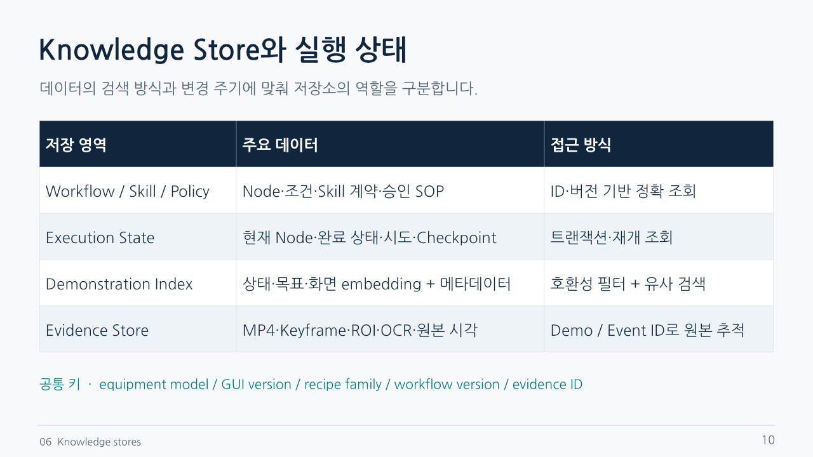

### 슬라이드 본문

데이터의 검색 방식과 변경 주기에 맞춰 저장소의 역할을 구분합니다.

| 저장 영역 | 주요 데이터 | 접근 방식 |
| --- | --- | --- |
| Workflow / Skill / Policy | Node·조건·Skill 계약·승인 SOP | ID·버전 기반 정확 조회 |
| Execution State | 현재 Node·완료 상태·시도·Checkpoint | 트랜잭션·재개 조회 |
| Demonstration Index | 상태·목표·화면 embedding + 메타데이터 | 호환성 필터 + 유사 검색 |
| Evidence Store | MP4·Keyframe·ROI·OCR·원본 시각 | Demo / Event ID로 원본 추적 |

공통 키  ·  equipment model / GUI version / recipe family / workflow version / evidence ID

### 발표자 노트

설계 원문: LLM 분기 컨텍스트 설계, 2026-11-08. https://chatgpt.com/c/6aef1bcb-8588-83ee-8cc6-5ddc88f7b521
본 자료는 제안 설계입니다. 실장비 운영 성능 또는 배포 완료를 의미하지 않습니다.

PoC는 파일 기반 JSON/YAML + SQL 상태 DB + 필요 시 벡터 인덱스로 시작할 수 있습니다. 이 표는 논리적 분리이며 저장 시스템 수를 강제하지 않습니다. Skill Library는 사전·사후조건, 인자, Locator 전략, timeout, 허용 복구를 포함합니다. 외부 반출 정책에 맞춰 사내 저장소와 모델 실행 위치를 결정합니다.

슬라이드 하단 표기: 06  Knowledge stores / 10

## 슬라이드 11: State-conditioned Demonstration Retrieval

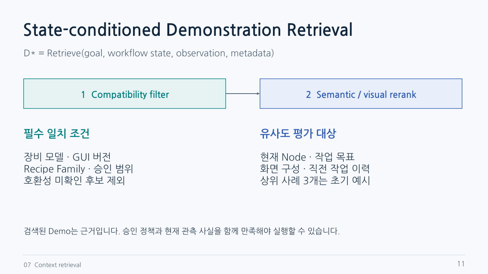

### 슬라이드 본문

D* = Retrieve(goal, workflow state, observation, metadata)

1  Compatibility filter

2  Semantic / visual rerank

필수 일치 조건

장비 모델 · GUI 버전
Recipe Family · 승인 범위
호환성 미확인 후보 제외

유사도 평가 대상

현재 Node · 작업 목표
화면 구성 · 직전 작업 이력
상위 사례 3개는 초기 예시

검색된 Demo는 근거입니다. 승인 정책과 현재 관측 사실을 함께 만족해야 실행할 수 있습니다.

### 발표자 노트

설계 원문: LLM 분기 컨텍스트 설계, 2026-11-08. https://chatgpt.com/c/6aef1bcb-8588-83ee-8cc6-5ddc88f7b521
본 자료는 제안 설계입니다. 실장비 운영 성능 또는 배포 완료를 의미하지 않습니다.

가중치와 top-k는 held-out 데이터로 평가할 설계 파라미터입니다. 호환성은 유사도 점수로 보상하지 않습니다. 후보가 없거나 baseline이 보이지 않으면 request_review가 허용되는 정상 결과입니다.

슬라이드 하단 표기: 07  Context retrieval / 11

## 슬라이드 12: Decision Context의 데이터 계약

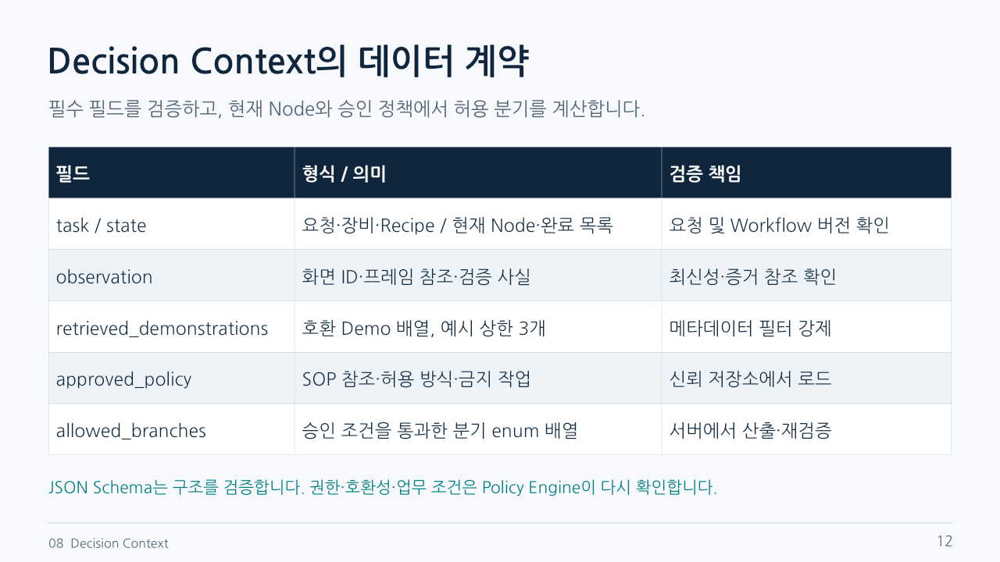

### 슬라이드 본문

필수 필드를 검증하고, 현재 Node와 승인 정책에서 허용 분기를 계산합니다.

| 필드 | 형식 / 의미 | 검증 책임 |
| --- | --- | --- |
| task / state | 요청·장비·Recipe / 현재 Node·완료 목록 | 요청 및 Workflow 버전 확인 |
| observation | 화면 ID·프레임 참조·검증 사실 | 최신성·증거 참조 확인 |
| retrieved_demonstrations | 호환 Demo 배열, 예시 상한 3개 | 메타데이터 필터 강제 |
| approved_policy | SOP 참조·허용 방식·금지 작업 | 신뢰 저장소에서 로드 |
| allowed_branches | 승인 조건을 통과한 분기 enum 배열 | 서버에서 산출·재검증 |

JSON Schema는 구조를 검증합니다. 권한·호환성·업무 조건은 Policy Engine이 다시 확인합니다.

### 발표자 노트

설계 원문: LLM 분기 컨텍스트 설계, 2026-11-08. https://chatgpt.com/c/6aef1bcb-8588-83ee-8cc6-5ddc88f7b521
본 자료는 제안 설계입니다. 실장비 운영 성능 또는 배포 완료를 의미하지 않습니다.

다음 2장은 단일 Decision Context의 필드 묶음을 나눠 보여줍니다. 모든 값은 가상 예시입니다. 발표자 노트에 전체 JSON Schema Draft 2020-12 제안과 전체 예시를 제공합니다. 실제 상태 enum은 승인 Workflow에서 관리하며 schema 통과가 SOP 승인을 뜻하지 않습니다.

#### 전체 JSON Schema:

```json
{
  "$schema": "https://json-schema.org/draft/2020-12/schema",
  "title": "DecisionContext",
  "type": "object",
  "additionalProperties": false,
  "required": [
    "task",
    "state",
    "observation",
    "retrieved_demonstrations",
    "approved_policy",
    "allowed_branches"
  ],
  "properties": {
    "task": {
      "type": "object",
      "additionalProperties": false,
      "required": [
        "request_id",
        "operation",
        "equipment",
        "recipe_family",
        "target_name"
      ],
      "properties": {
        "request_id": {
          "type": "string",
          "minLength": 1
        },
        "operation": {
          "enum": [
            "create_recipe_draft",
            "modify_recipe_draft"
          ]
        },
        "equipment": {
          "type": "string",
          "minLength": 1
        },
        "recipe_family": {
          "type": "string",
          "minLength": 1
        },
        "target_name": {
          "type": "string",
          "minLength": 1
        }
      }
    },
    "state": {
      "type": "object",
      "additionalProperties": false,
      "required": [
        "workflow_id",
        "current_node",
        "completed_nodes"
      ],
      "properties": {
        "workflow_id": {
          "type": "string",
          "minLength": 1
        },
        "current_node": {
          "type": "string",
          "minLength": 1
        },
        "completed_nodes": {
          "type": "array",
          "items": {
            "type": "string"
          },
          "uniqueItems": true
        }
      }
    },
    "observation": {
      "type": "object",
      "additionalProperties": false,
      "required": [
        "screen_id",
        "screenshot_ref",
        "verified_facts"
      ],
      "properties": {
        "screen_id": {
          "type": "string",
          "minLength": 1
        },
        "screenshot_ref": {
          "type": "string",
          "minLength": 1
        },
        "verified_facts": {
          "type": "array",
          "items": {
            "type": "string"
          },
          "uniqueItems": true
        }
      }
    },
    "retrieved_demonstrations": {
      "type": "array",
      "maxItems": 3,
      "items": {
        "type": "object",
        "additionalProperties": false,
        "required": [
          "demo_id",
          "workflow_node",
          "before_frame",
          "after_frame",
          "applicability"
        ],
        "properties": {
          "demo_id": {
            "type": "string"
          },
          "workflow_node": {
            "type": "string"
          },
          "before_frame": {
            "type": "string"
          },
          "after_frame": {
            "type": "string"
          },
          "applicability": {
            "const": "compatible"
          }
        }
      }
    },
    "approved_policy": {
      "type": "object",
      "additionalProperties": false,
      "required": [
        "source",
        "creation_method",
        "allow_overwrite",
        "allow_activation"
      ],
      "properties": {
        "source": {
          "type": "string",
          "minLength": 1
        },
        "creation_method": {
          "enum": [
            "copy_approved_baseline",
            "edit_approved_draft"
          ]
        },
        "allow_overwrite": {
          "const": false
        },
        "allow_activation": {
          "const": false
        }
      }
    },
    "allowed_branches": {
      "type": "array",
      "minItems": 1,
      "uniqueItems": true,
      "items": {
        "enum": [
          "copy_approved_baseline",
          "edit_approved_draft",
          "request_review"
        ]
      }
    }
  }
}
```

#### 전체 예시:

```json
{
  "task": {
    "request_id": "CR-1024",
    "operation": "create_recipe_draft",
    "equipment": "EQUIP_A",
    "recipe_family": "FAMILY_X",
    "target_name": "DRAFT_X_01"
  },
  "state": {
    "workflow_id": "WF_CREATE_V3",
    "current_node": "select_creation_method",
    "completed_nodes": [
      "verify_equipment",
      "open_recipe_manager"
    ]
  },
  "observation": {
    "screen_id": "recipe_manager",
    "screenshot_ref": "LIVE_FRAME_018",
    "verified_facts": [
      "baseline_verified",
      "copy_visible"
    ]
  },
  "retrieved_demonstrations": [
    {
      "demo_id": "DEMO_014",
      "workflow_node": "select_creation_method",
      "before_frame": "F28",
      "after_frame": "F35",
      "applicability": "compatible"
    }
  ],
  "approved_policy": {
    "source": "SOP_RECIPE_V3",
    "creation_method": "copy_approved_baseline",
    "allow_overwrite": false,
    "allow_activation": false
  },
  "allowed_branches": [
    "copy_approved_baseline",
    "request_review"
  ]
}
```

슬라이드 하단 표기: 08  Decision Context / 12

## 슬라이드 13: Decision Context JSON · 작업과 현재 상태

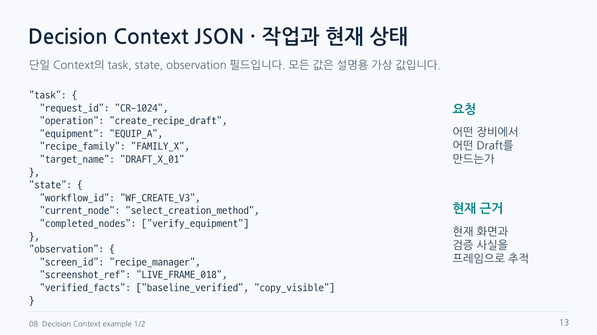

### 슬라이드 본문

단일 Context의 task, state, observation 필드입니다. 모든 값은 설명용 가상 값입니다.

```json
"task": {
  "request_id": "CR-1024",
  "operation": "create_recipe_draft",
  "equipment": "EQUIP_A",
  "recipe_family": "FAMILY_X",
  "target_name": "DRAFT_X_01"
},
"state": {
  "workflow_id": "WF_CREATE_V3",
  "current_node": "select_creation_method",
  "completed_nodes": ["verify_equipment"]
},
"observation": {
  "screen_id": "recipe_manager",
  "screenshot_ref": "LIVE_FRAME_018",
  "verified_facts": ["baseline_verified", "copy_visible"]
}
```

요청

어떤 장비에서
어떤 Draft를
만드는가

현재 근거

현재 화면과
검증 사실을
프레임으로 추적

### 발표자 노트

설계 원문: LLM 분기 컨텍스트 설계, 2026-11-08. https://chatgpt.com/c/6aef1bcb-8588-83ee-8cc6-5ddc88f7b521
본 자료는 제안 설계입니다. 실장비 운영 성능 또는 배포 완료를 의미하지 않습니다.

표시된 코드는 단일 객체의 내부 필드 일부입니다. observation.verified_facts는 VLM의 주장만으로 채우지 않고 OCR·UI 상태·장비 식별 등 해당 사실의 검사 결과를 연결합니다. completed_nodes 목록은 지면을 위해 축약했습니다.

슬라이드 하단 표기: 08  Decision Context example 1/2 / 13

## 슬라이드 14: Decision Context JSON · 근거와 허용 범위

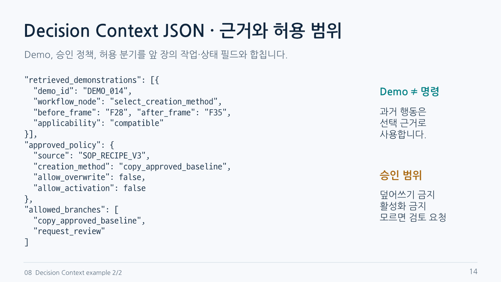

### 슬라이드 본문

Demo, 승인 정책, 허용 분기를 앞 장의 작업·상태 필드와 합칩니다.

```json
"retrieved_demonstrations": [{
  "demo_id": "DEMO_014",
  "workflow_node": "select_creation_method",
  "before_frame": "F28", "after_frame": "F35",
  "applicability": "compatible"
}],
"approved_policy": {
  "source": "SOP_RECIPE_V3",
  "creation_method": "copy_approved_baseline",
  "allow_overwrite": false,
  "allow_activation": false
},
"allowed_branches": [
  "copy_approved_baseline",
  "request_review"
]
```

Demo ≠ 명령

과거 행동은
선택 근거로
사용합니다.

승인 범위

덮어쓰기 금지
활성화 금지
모르면 검토 요청

### 발표자 노트

설계 원문: LLM 분기 컨텍스트 설계, 2026-11-08. https://chatgpt.com/c/6aef1bcb-8588-83ee-8cc6-5ddc88f7b521
본 자료는 제안 설계입니다. 실장비 운영 성능 또는 배포 완료를 의미하지 않습니다.

표시된 코드는 단일 객체의 내부 필드 일부입니다. approved_policy는 신뢰 저장소가 제공하며 화면 OCR이나 검색 문서의 지시가 덮어쓸 수 없습니다. retrieved evidence에 포함된 UI 텍스트는 데이터로 취급합니다.

슬라이드 하단 표기: 08  Decision Context example 2/2 / 14

## 슬라이드 15: Decision · Policy · Execution 분리

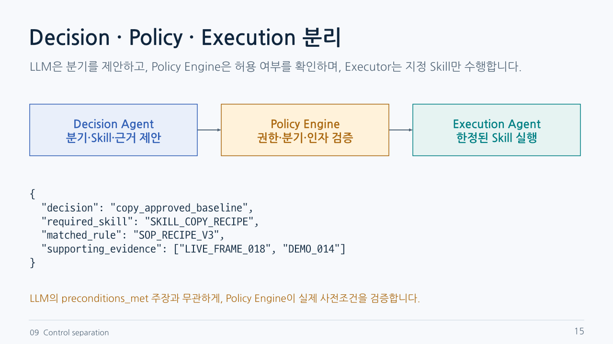

### 슬라이드 본문

LLM은 분기를 제안하고, Policy Engine은 허용 여부를 확인하며, Executor는 지정 Skill만 수행합니다.

Decision Agent
분기·Skill·근거 제안

Policy Engine
권한·분기·인자 검증

Execution Agent
한정된 Skill 실행

```json
{
  "decision": "copy_approved_baseline",
  "required_skill": "SKILL_COPY_RECIPE",
  "matched_rule": "SOP_RECIPE_V3",
  "supporting_evidence": ["LIVE_FRAME_018", "DEMO_014"]
}
```

LLM의 preconditions_met 주장과 무관하게, Policy Engine이 실제 사전조건을 검증합니다.

### 발표자 노트

설계 원문: LLM 분기 컨텍스트 설계, 2026-11-08. https://chatgpt.com/c/6aef1bcb-8588-83ee-8cc6-5ddc88f7b521
본 자료는 제안 설계입니다. 실장비 운영 성능 또는 배포 완료를 의미하지 않습니다.

Executor에 임의 메뉴 탐색이나 추가 Recipe 수정 권한을 주지 않습니다. skill ID, 인자 스키마, 변경 대상, 허용 값·단위, Workflow 버전과 승인 정책을 서버가 검증합니다. Policy가 거부하면 실행 단계로 전달하지 않습니다.

슬라이드 하단 표기: 09  Control separation / 15

## 슬라이드 16: Online 실행 루프와 Checkpoint

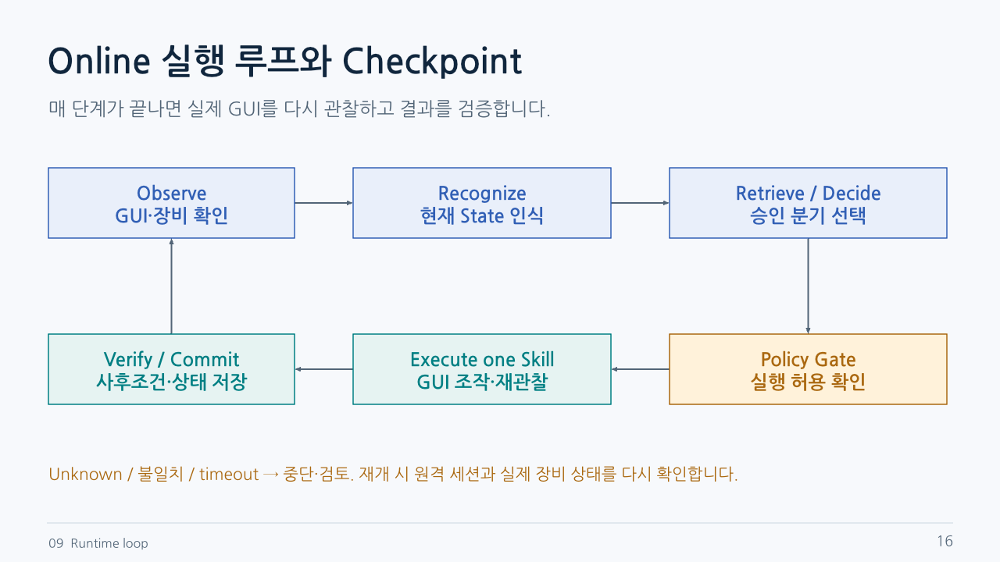

### 슬라이드 본문

매 단계가 끝나면 실제 GUI를 다시 관찰하고 결과를 검증합니다.

Observe
GUI·장비 확인

Recognize
현재 State 인식

Retrieve / Decide
승인 분기 선택

Policy Gate
실행 허용 확인

Execute one Skill
GUI 조작·재관찰

Verify / Commit
사후조건·상태 저장

Unknown / 불일치 / timeout → 중단·검토. 재개 시 원격 세션과 실제 장비 상태를 다시 확인합니다.

### 발표자 노트

설계 원문: LLM 분기 컨텍스트 설계, 2026-11-08. https://chatgpt.com/c/6aef1bcb-8588-83ee-8cc6-5ddc88f7b521
본 자료는 제안 설계입니다. 실장비 운영 성능 또는 배포 완료를 의미하지 않습니다.

Checkpoint는 소프트웨어 실행 위치를 복원합니다. 원격 GUI나 장비 자체를 되돌리지 않습니다. 완료 저장은 사후조건 확인 이후에만 수행합니다. 통신 단절 중 실행 여부가 불명확하면 재시도보다 실제 결과 조회를 먼저 합니다.

슬라이드 하단 표기: 09  Runtime loop / 16

## 슬라이드 17: Bounded Skill 실행 계약

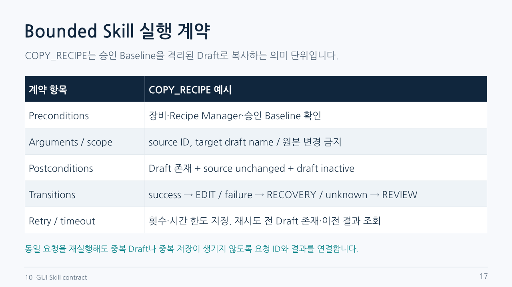

### 슬라이드 본문

COPY_RECIPE는 승인 Baseline을 격리된 Draft로 복사하는 의미 단위입니다.

| 계약 항목 | COPY_RECIPE 예시 |
| --- | --- |
| Preconditions | 장비·Recipe Manager·승인 Baseline 확인 |
| Arguments / scope | source ID, target draft name / 원본 변경 금지 |
| Postconditions | Draft 존재 + source unchanged + draft inactive |
| Transitions | success → EDIT / failure → RECOVERY / unknown → REVIEW |
| Retry / timeout | 횟수·시간 한도 지정. 재시도 전 Draft 존재·이전 결과 조회 |

동일 요청을 재실행해도 중복 Draft나 중복 저장이 생기지 않도록 요청 ID와 결과를 연결합니다.

### 발표자 노트

설계 원문: LLM 분기 컨텍스트 설계, 2026-11-08. https://chatgpt.com/c/6aef1bcb-8588-83ee-8cc6-5ddc88f7b521
본 자료는 제안 설계입니다. 실장비 운영 성능 또는 배포 완료를 의미하지 않습니다.

max_retries=1은 원문의 예시이며 모든 GUI 작업에 일괄 적용할 기본값이 아닙니다. 읽기·조회는 제한적으로 재시도할 수 있으나 저장·복사 등 변경 작업은 실행 여부 확인 후에만 재시도합니다. 재시도 불가 상태에서는 HUMAN_REVIEW로 전이합니다.

슬라이드 하단 표기: 10  GUI Skill contract / 17

## 슬라이드 18: Recipe 변경 안전 게이트

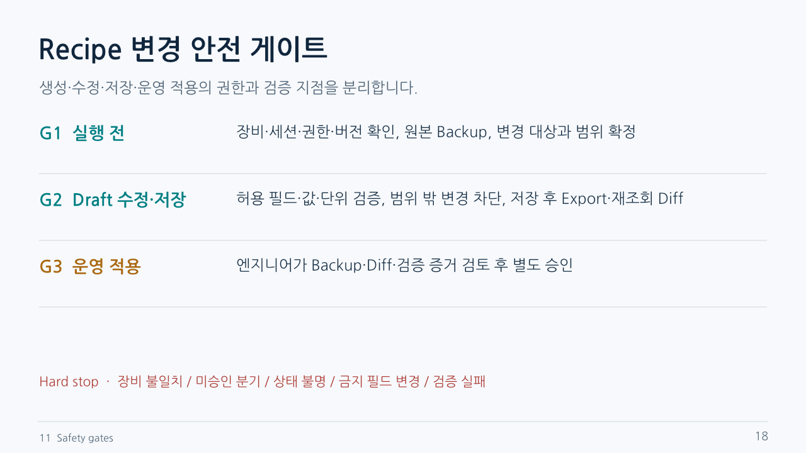

### 슬라이드 본문

생성·수정·저장·운영 적용의 권한과 검증 지점을 분리합니다.

G1  실행 전

장비·세션·권한·버전 확인, 원본 Backup, 변경 대상과 범위 확정

G2  Draft 수정·저장

허용 필드·값·단위 검증, 범위 밖 변경 차단, 저장 후 Export·재조회 Diff

G3  운영 적용

엔지니어가 Backup·Diff·검증 증거 검토 후 별도 승인

Hard stop  ·  장비 불일치 / 미승인 분기 / 상태 불명 / 금지 필드 변경 / 검증 실패

### 발표자 노트

설계 원문: LLM 분기 컨텍스트 설계, 2026-11-08. https://chatgpt.com/c/6aef1bcb-8588-83ee-8cc6-5ddc88f7b521
본 자료는 제안 설계입니다. 실장비 운영 성능 또는 배포 완료를 의미하지 않습니다.

PoC 기본 정책은 overwrite=false, activation=false입니다. 운영 적용은 별도 작업·승인 대상으로 남깁니다. 원복은 실제 복구 가능성을 검증한 절차가 있을 때만 수행하며, 임의 Undo나 자동 재입력으로 해결하지 않습니다. 감사 이력에는 요청, 정책·Skill 버전, 전후 증거, Diff, 승인자를 남깁니다.

슬라이드 하단 표기: 11  Safety gates / 18

## 슬라이드 19: Recipe 수정 시나리오

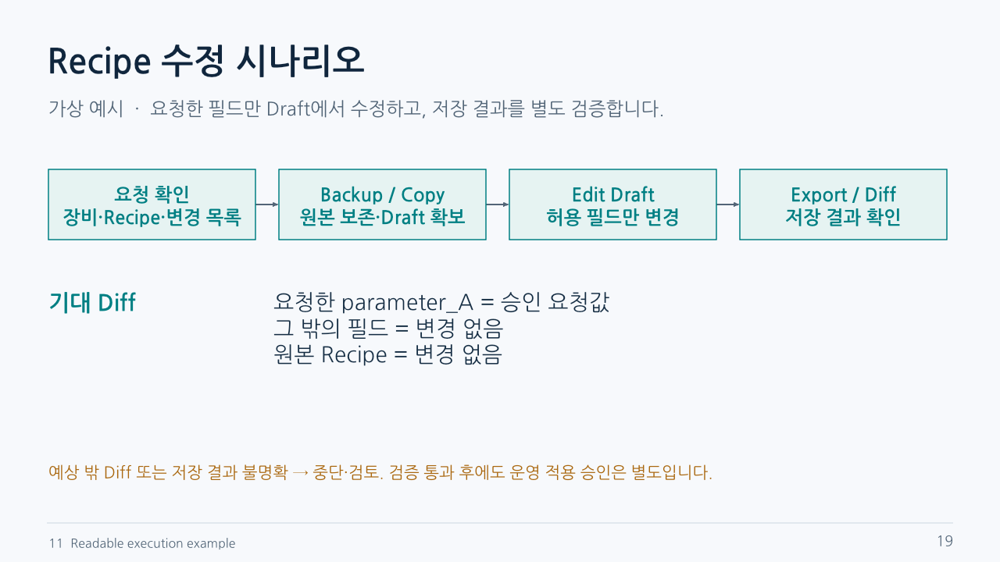

### 슬라이드 본문

가상 예시  ·  요청한 필드만 Draft에서 수정하고, 저장 결과를 별도 검증합니다.

요청 확인
장비·Recipe·변경 목록

Backup / Copy
원본 보존·Draft 확보

Edit Draft
허용 필드만 변경

Export / Diff
저장 결과 확인

기대 Diff

요청한 parameter_A = 승인 요청값
그 밖의 필드 = 변경 없음
원본 Recipe = 변경 없음

예상 밖 Diff 또는 저장 결과 불명확 → 중단·검토. 검증 통과 후에도 운영 적용 승인은 별도입니다.

### 발표자 노트

설계 원문: LLM 분기 컨텍스트 설계, 2026-11-08. https://chatgpt.com/c/6aef1bcb-8588-83ee-8cc6-5ddc88f7b521
본 자료는 제안 설계입니다. 실장비 운영 성능 또는 배포 완료를 의미하지 않습니다.

수치는 실제 공정 파라미터로 오해하지 않도록 생략했습니다. 실제 구현에서는 단위, 정밀도, 허용 범위, 상호 의존 조건을 승인 정책에 포함해야 합니다. 화면 값 표시, 편집 추정, 저장 확인을 다른 상태로 기록합니다.

슬라이드 하단 표기: 11  Readable execution example / 19

## 슬라이드 20: Held-out 평가와 정보 누수 방지

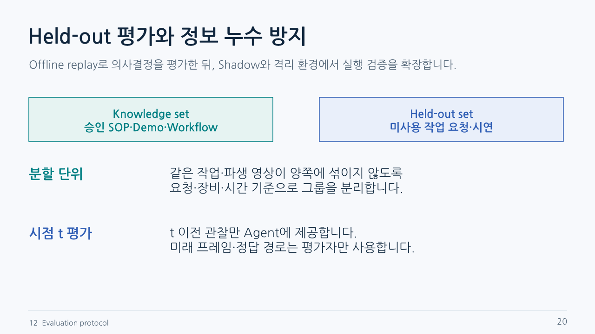

### 슬라이드 본문

Offline replay로 의사결정을 평가한 뒤, Shadow와 격리 환경에서 실행 검증을 확장합니다.

Knowledge set
승인 SOP·Demo·Workflow

Held-out set
미사용 작업 요청·시연

분할 단위

같은 작업·파생 영상이 양쪽에 섞이지 않도록
요청·장비·시간 기준으로 그룹을 분리합니다.

시점 t 평가

t 이전 관찰만 Agent에 제공합니다.
미래 프레임·정답 경로는 평가자만 사용합니다.

### 발표자 노트

설계 원문: LLM 분기 컨텍스트 설계, 2026-11-08. https://chatgpt.com/c/6aef1bcb-8588-83ee-8cc6-5ddc88f7b521
본 자료는 제안 설계입니다. 실장비 운영 성능 또는 배포 완료를 의미하지 않습니다.

Offline 추출은 전후 프레임을 이용할 수 있지만, Online 의사결정 평가에서는 해당 시점 미래의 프레임이나 mined branch 정답이 context에 유입되지 않도록 합니다. 평가 대상의 시연은 Demo Index, 임베딩 캐시, Workflow 추출 데이터에서도 제외합니다. Offline replay로 GUI 조작 성공률을 주장할 수 없습니다.

슬라이드 하단 표기: 12  Evaluation protocol / 20

## 슬라이드 21: PoC 평가 지표와 측정 단위

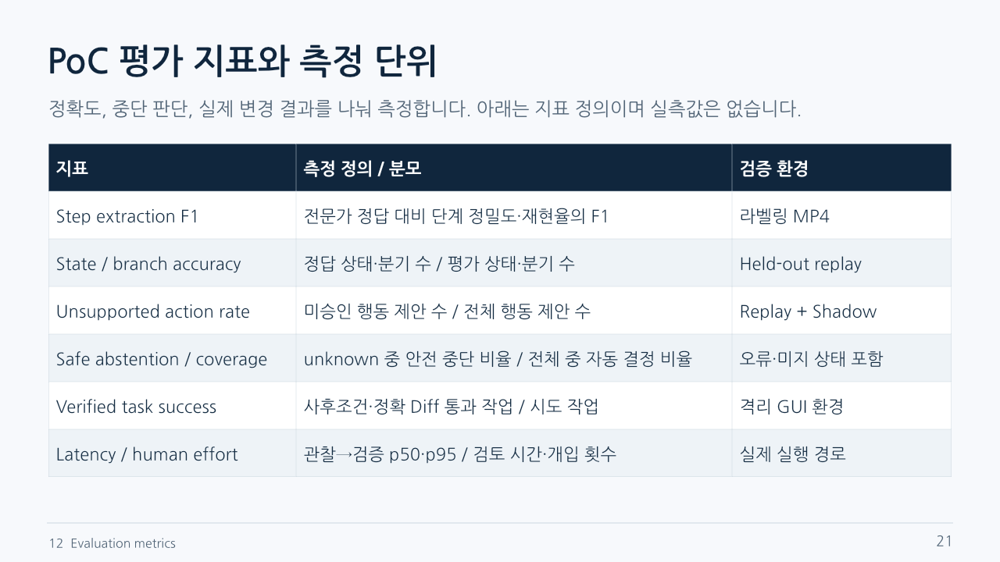

### 슬라이드 본문

정확도, 중단 판단, 실제 변경 결과를 나눠 측정합니다. 아래는 지표 정의이며 실측값은 없습니다.

| 지표 | 측정 정의 / 분모 | 검증 환경 |
| --- | --- | --- |
| Step extraction F1 | 전문가 정답 대비 단계 정밀도·재현율의 F1 | 라벨링 MP4 |
| State / branch accuracy | 정답 상태·분기 수 / 평가 상태·분기 수 | Held-out replay |
| Unsupported action rate | 미승인 행동 제안 수 / 전체 행동 제안 수 | Replay + Shadow |
| Safe abstention / coverage | unknown 중 안전 중단 비율 / 전체 중 자동 결정 비율 | 오류·미지 상태 포함 |
| Verified task success | 사후조건·정확 Diff 통과 작업 / 시도 작업 | 격리 GUI 환경 |
| Latency / human effort | 관찰→검증 p50·p95 / 검토 시간·개입 횟수 | 실제 실행 경로 |

### 발표자 노트

설계 원문: LLM 분기 컨텍스트 설계, 2026-11-08. https://chatgpt.com/c/6aef1bcb-8588-83ee-8cc6-5ddc88f7b521
본 자료는 제안 설계입니다. 실장비 운영 성능 또는 배포 완료를 의미하지 않습니다.

State와 branch는 별도 집계합니다. 자동 결정만의 branch accuracy와 전체 coverage를 함께 보고합니다. Hard-stop 사례에서 위험 실행이 나온 건수도 보고하며, 표본에서 0건이어도 무위험을 증명하지 않습니다. 잘못된 값 저장·원본 변경·활성화 건수를 별도 안전 지표로 둡니다. p50/p95는 모델 API 응답 시간이 아니라 관찰, 검색, 판단, 실행, 검증을 포함하는 실제 경로를 대상으로 하고, 실패·timeout·표본 수를 함께 보고합니다. 수치 목표와 운영 허용 수준은 담당자가 PoC 시작 전 합의합니다.

슬라이드 하단 표기: 12  Evaluation metrics / 21

## 슬라이드 22: PoC 마일스톤과 통과 조건

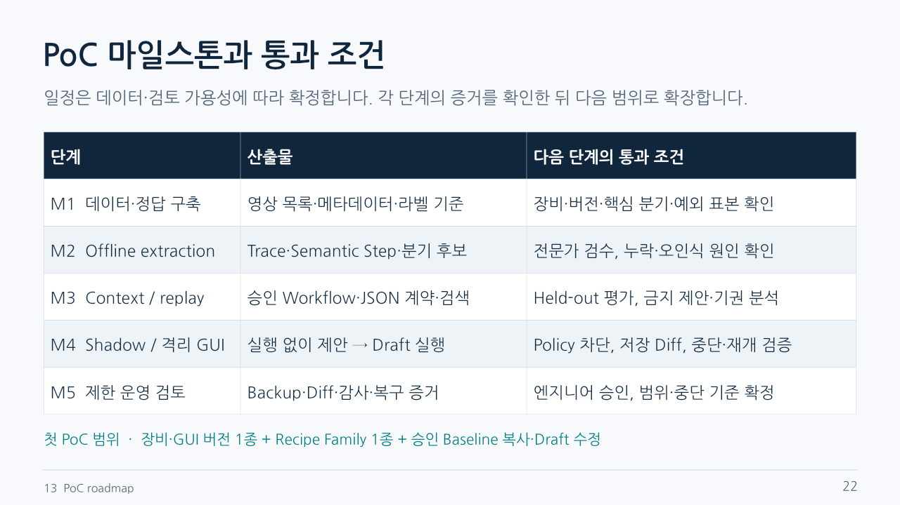

### 슬라이드 본문

일정은 데이터·검토 가용성에 따라 확정합니다. 각 단계의 증거를 확인한 뒤 다음 범위로 확장합니다.

| 단계 | 산출물 | 다음 단계의 통과 조건 |
| --- | --- | --- |
| M1  데이터·정답 구축 | 영상 목록·메타데이터·라벨 기준 | 장비·버전·핵심 분기·예외 표본 확인 |
| M2  Offline extraction | Trace·Semantic Step·분기 후보 | 전문가 검수, 누락·오인식 원인 확인 |
| M3  Context / replay | 승인 Workflow·JSON 계약·검색 | Held-out 평가, 금지 제안·기권 분석 |
| M4  Shadow / 격리 GUI | 실행 없이 제안 → Draft 실행 | Policy 차단, 저장 Diff, 중단·재개 검증 |
| M5  제한 운영 검토 | Backup·Diff·감사·복구 증거 | 엔지니어 승인, 범위·중단 기준 확정 |

첫 PoC 범위  ·  장비·GUI 버전 1종 + Recipe Family 1종 + 승인 Baseline 복사·Draft 수정

### 발표자 노트

설계 원문: LLM 분기 컨텍스트 설계, 2026-11-08. https://chatgpt.com/c/6aef1bcb-8588-83ee-8cc6-5ddc88f7b521
본 자료는 제안 설계입니다. 실장비 운영 성능 또는 배포 완료를 의미하지 않습니다.

마일스톤과 범위는 본 발표자료에서 제안하는 실행 순서입니다. 완료된 개발이나 운영 결과를 뜻하지 않습니다. 시작 전 데이터 반출, 모델·저장소의 사내 배치, 장비 접근 권한, 평가 기준과 승인 책임자를 확정합니다. 첫 단계에서는 실제 MP4 표본과 SOP로 라벨 품질을 확인합니다. 운영 Recipe의 자동 적용은 별도 승인 범위입니다.

슬라이드 하단 표기: 13  PoC roadmap / 22

## 참고 자료 (References)

- [완성된 PowerPoint 발표자료](../video_to_workflow_recipe_agent.pptx)
- [설계 원문 대화: LLM 분기 컨텍스트 설계](https://chatgpt.com/c/6aef1bcb-8588-83ee-8cc6-5ddc88f7b521)
